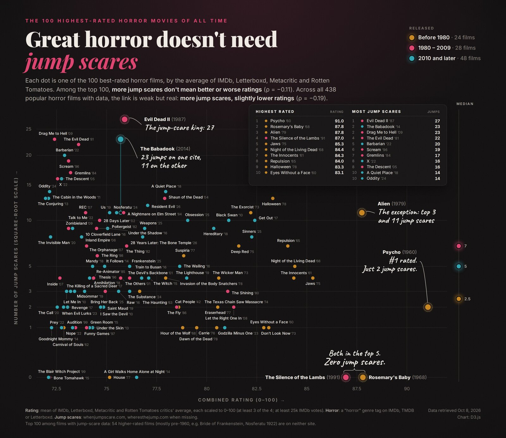
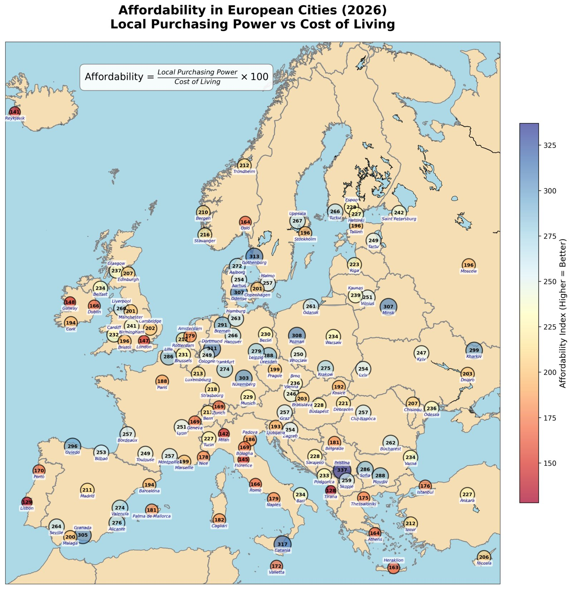
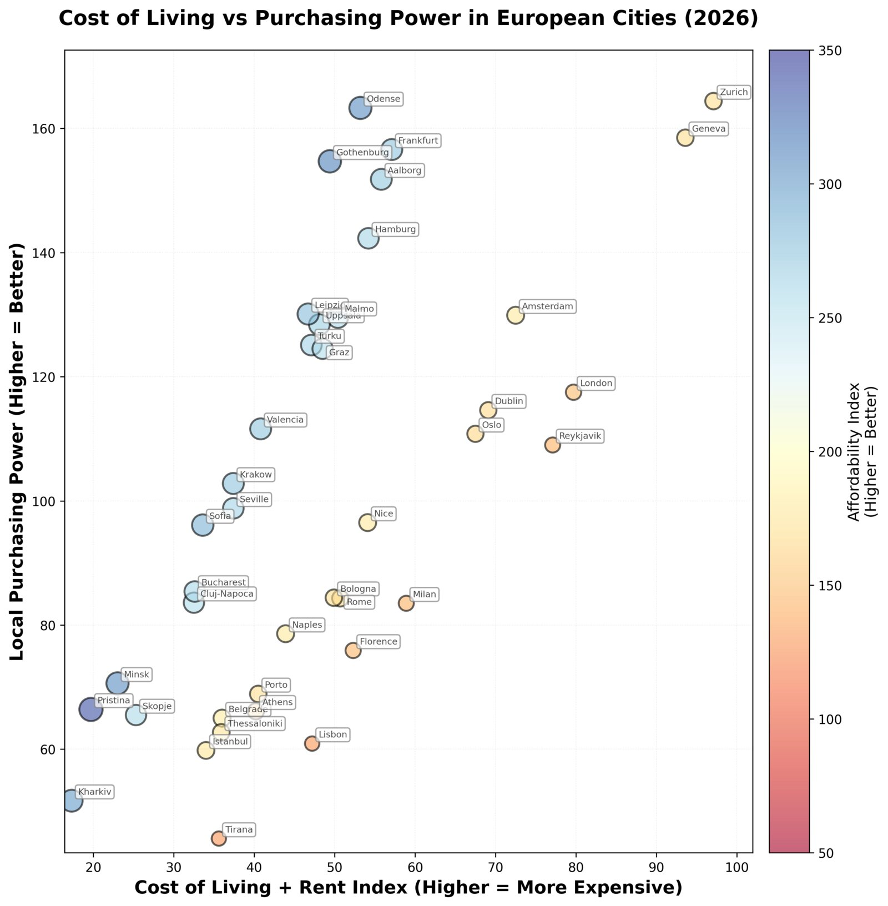
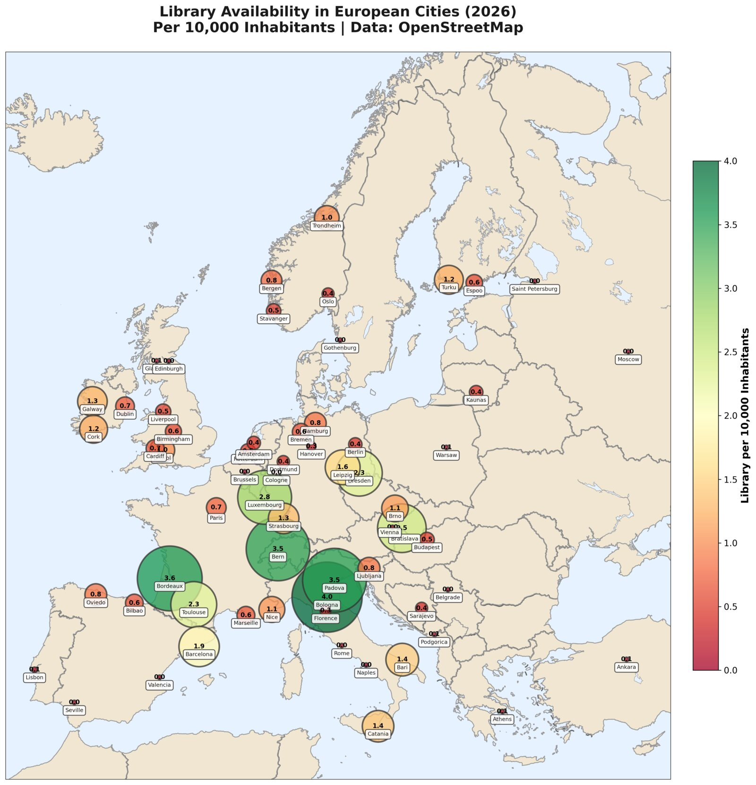
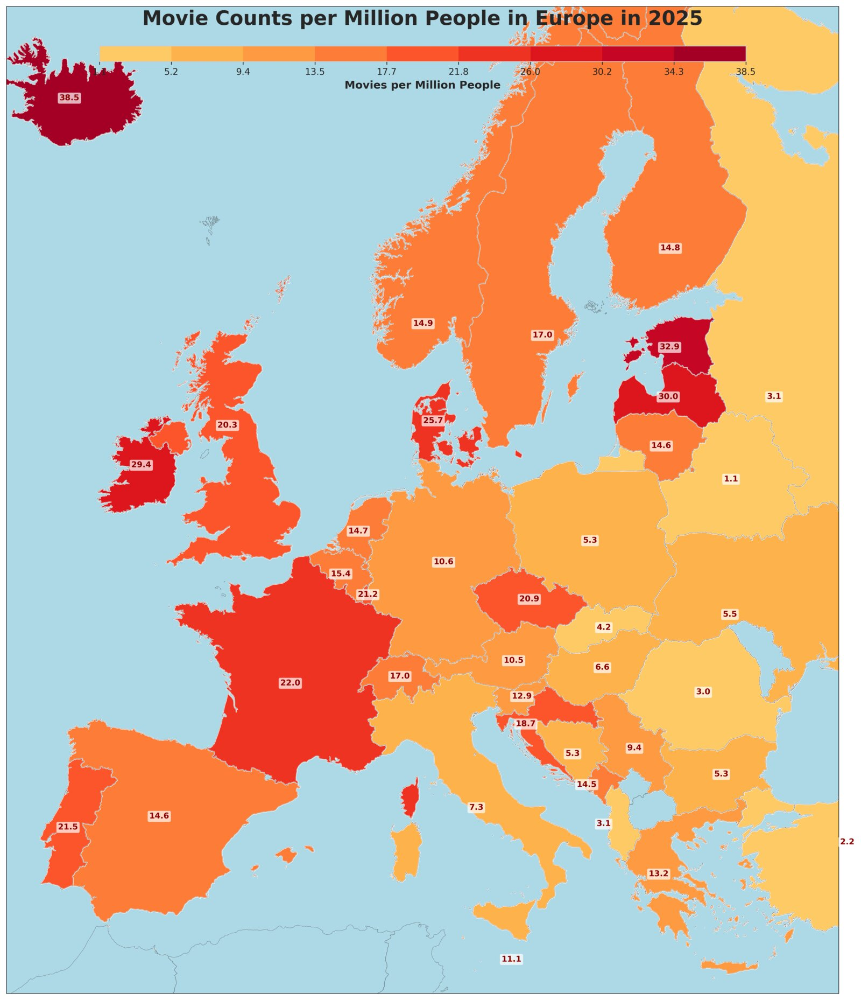
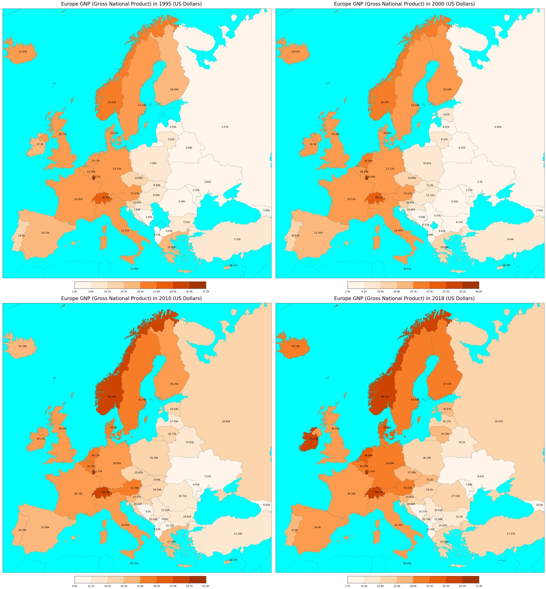
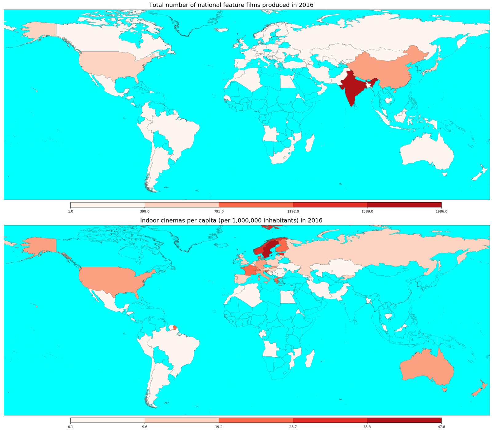
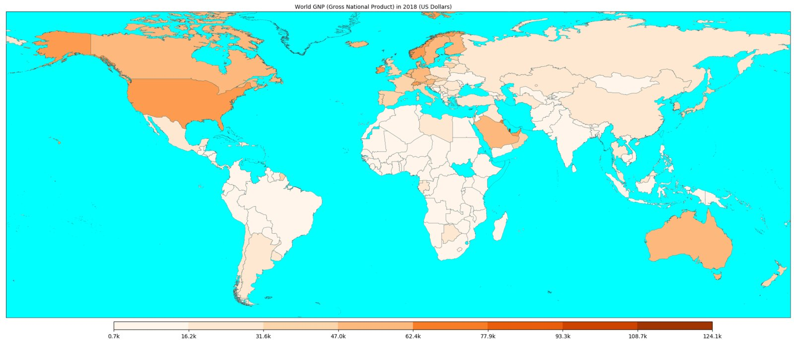

# Mapy

Maps and figures made from open data: country and city statistics on maps of Europe and the
world, and a few charts about movies.



## Gallery

| | |
|---|---|
|  |  |
| Affordability in European cities, 2026 ([cost_of_living](projects/cost_of_living)) | Cost of living vs. purchasing power, 2026 ([cost_of_living](projects/cost_of_living)) |
|  |  |
| Libraries per 10,000 inhabitants in European cities ([osm_amenities](projects/osm_amenities)) | Movies per million people in Europe, 2025 ([cinema](projects/cinema)) |
|  |  |
| Europe GNP over four years ([gnp](projects/gnp)) | Films produced and cinemas per capita, 2016 ([cinema](projects/cinema)) |


World GNP, 2018 ([gnp](projects/gnp))

## Repository layout

```
mapy/                      Shared package: map regions, city data, repository paths
projects/
    cinema/                Movies and cinemas per country (UNESCO, TMDB, Wikidata)
    cost_of_living/        Cost of living and affordability in European cities (Numbeo)
    gnp/                   Gross national product maps (World Bank)
    horror_jump_scares/    Horror movie ratings vs. jump scares (D3.js poster)
    osm_amenities/         Libraries, theatres, cinemas per city (OpenStreetMap)
    sandbox/               Basemap experiments
tools/                     ImageMagick helpers to stitch figures together
docs/                      Data sources and README images
data/                      Inputs, caches and outputs (not tracked, see docs/data_sources.md)
```

## Setup

```bash
pip install -r requirements.txt
pip install -e .                  # Makes `mapy` importable from scripts and notebooks
playwright install chromium       # Only for the horror poster screenshot
```

Basemap needs the PROJ library; installing it with conda (`conda install -c conda-forge basemap`)
is usually the easiest route.

Paths are resolved from the repository root (`mapy/paths.py`), so scripts and notebooks run from
any directory. Inputs are read from `data/` and figures are written to `data/output/`. The input
files are not in the repository: [docs/data_sources.md](docs/data_sources.md) lists where each
one comes from.

```bash
python projects/gnp/plot_gnp.py
python projects/horror_jump_scares/plot_horror_jump_scares_web.py
```

Notebooks are committed without outputs.

## License

The code is released under the [MIT License](LICENSE). The data shown in the figures belongs to
its sources, listed in [docs/data_sources.md](docs/data_sources.md), and follows their terms.
